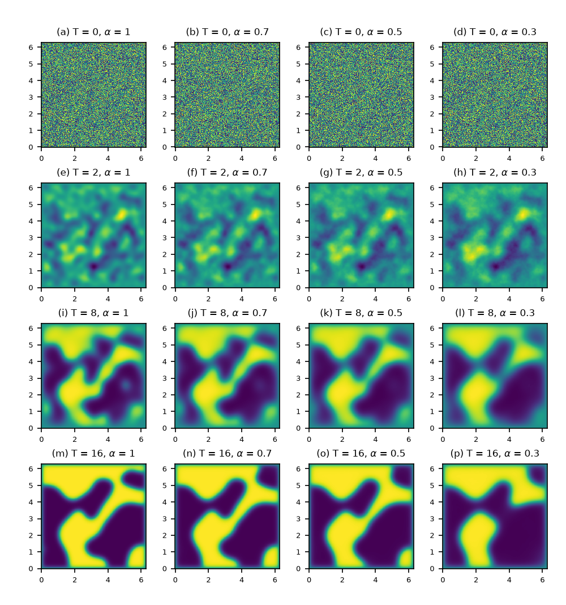

# Time Fractional Allen-Cahn Equation

本仓库参考论文 *J. Jia, H. Zhang, H. Xu, X. Jiang, "A fast stabilized ADI method
for time-fractional Allen-Cahn equation", Applied Numerical Mathematics 165
(2021) 216–231* 中 **Example 2** 的数值模拟：

$$
\mathrm{D}_t^\alpha u - \mu\,\Delta u + (u - u^3) = 0,
\qquad (x,y) \in [0, 2\pi]^2,\; t \in (0, T],
$$

$$
u(x,y,0) = 0.05\,(2\,\mathrm{rand}(x,y) - 1),
\qquad u|_{\partial\Omega} = 0,
$$

其中 $\mathrm{D}_t^\alpha$ 为 Caputo 分数阶导数（0 < \alpha \le 1），$\mu = \varepsilon^2 = 0.01$。时间方向用分数阶 BDF2（FBDF2），空间方向用五点中心差分 + ADI 分裂（含混合导数修正项），具体的离散方法实现见下文“离散化与矩阵方法构造”部分。



图：不同分数阶阶数与终止时间T下的相场演化（N=25，$\tau=0.005$）。可以看到随着 $\alpha$ 减小，粗化到达平衡所需的时间变长。

---

## 项目结构

```
├── main.py                # 入口：计算全部参数组合并出图
├── config.py              # 全部可调参数与输出路径
├── adi_solver.py          # FBDF2-ADI 求解器
├── fractional_weights.py  # FBDF2 卷积权重的递推
├── plotting.py            # 演化图的绘制
├── requirements.txt       # 依赖清单
├── run.sh                 # 一键配置环境并运行
├── .gitignore
└── case5_results/
    ├── figures/case5_4x4.png   # 演化图（每次运行自动重生成）
    └── data/*.mat              # 各组合的终值解（运行生成，不进仓库）
```

## 快速开始

```bash
./run.sh           # 自动创建虚拟环境（或复用已有的）+ 安装依赖 + 运行
./run.sh setup     # 只配置环境，不运行
```

或手动执行：

```bash
python3 -m venv .venv
.venv/bin/pip install -r requirements.txt
.venv/bin/python main.py
```

要求 Python ≥ 3.9（依赖：numpy、scipy、matplotlib，见 `requirements.txt`）。
程序会依次计算 `T_LIST × ALPHA_LIST` 共 16 个组合（总是重算并覆盖旧文件），
把每个组合的终值解保存为 `.mat`，最后重绘演化图。默认配置全套约 40 分钟
（`T = 16` 的组合最耗时，$N_t = 3200$）；想快速试跑可先在 `config.py` 里
缩小 `T_LIST` 或 `N`。

## 参数配置

全部参数集中在 `config.py`：

| 常量 | 默认值 | 说明 |
| --- | --- | --- |
| `ALPHA_LIST` | `[1.0, 0.7, 0.5, 0.3]` | 分数阶阶数，对应图的列（左→右） |
| `T_LIST` | `[0.0, 2.0, 8.0, 16.0]` | 终止时间，对应图的行（上→下） |
| `N` | `256` | 每个方向的区间数（$N_x = N_y$） |
| `TAU` | `0.005` | 时间步长 $\tau$ |
| `NODES` | `[0, 2π]` | 空间区域 $[a, b]^2$ |
| `SEED` | `10086` | 随机初值 $u_0 = 0.05(2\,\mathrm{rand}-1)$ 的种子 |
| `PARAMS` | `mu = 0.1**2` | 扩散系数 $\mu = \varepsilon^2$（求解器只读 `mu`） |

修改参数后直接运行`main.py` 即可，数据与图像都会更新。

---

## 离散化与矩阵方法构造

### 1. 连续问题

记 Caputo 分数阶导数为

$$
\mathrm{D}_t^\alpha u(t) = \frac{1}{\Gamma(1-\alpha)}
\int_0^t (t-s)^{-\alpha}\, u'(s)\,\mathrm{d}s, \qquad 0 < \alpha < 1.
$$

我们求解 Allen-Cahn 方程 $\mathrm{D}_t^\alpha u - \mu\Delta u + (u-u^3) = 0$，
即把经典 Allen-Cahn 方程的一阶时间导数换成 $\alpha$ 阶 Caputo 导数；
$\alpha=1$ 时退化为经典方程。

### 2. 时间离散：FBDF2

设 $t_n = n\tau$，$u^n \approx u(\cdot, t_n)$。经典二阶 BDF 的生成函数为

$$
\delta(\zeta) = \tfrac32 - 2\zeta + \tfrac12 \zeta^2,
$$

分数阶 BDF2（FBDF2）用它的 $\alpha$ 次幂生成离散卷积核：

$$
\big[\delta(\zeta)\big]^\alpha = \sum_{k=0}^{\infty} \omega_k \zeta^k.
$$

记 $(d_0, d_1, d_2) = (\tfrac32, -2, \tfrac12)$。由恒等式
$\delta W' = \alpha\,\delta' W$（其中 $W(\zeta) = [\delta(\zeta)]^\alpha$）
逐项比较系数，得到 `fractional_weights.py` 中的递推式：

$$
n\,d_0\,\omega_n =
\big[(\alpha+1-n)\,d_1\big]\,\omega_{n-1}
+ \big[\big(2(\alpha+1)-n\big)\,d_2\big]\,\omega_{n-2},
\qquad \omega_0 = d_0^{\,\alpha},
$$

（n=1 时第二项取 0）。因为 $\delta(1) = 0$，所以 $\sum_{k\ge0}\omega_k = 0$：
该离散算子对常数精确为零，这是下面初值修正恒等式的来源。

Caputo 导数的离散逼近取

$$
\mathrm{D}_\tau^\alpha u^n
= \tau^{-\alpha} \sum_{k=0}^{n} \omega_{n-k}\,(u^k - u^0)
= \tau^{-\alpha}\Big[
\omega_0 u^n + \sum_{k=0}^{n-1} \omega_{n-k}\,u^k - b_n u^0
\Big],
\qquad b_n := \sum_{k=0}^{n} \omega_k.
$$

等式中 $u^n$ 是未知量、留在方程左端（隐式）；$\sum_{k<n}\omega_{n-k}u^k$ 是
**历史卷积**，$-b_n u^0$ 是**初值修正**。这正是 `adi_solver.py` 中
`history` 与 `init_corr` 两项的来历。方程右端非线性项用二阶外推：

$$
\mathrm{D}_\tau^\alpha u^n
= \mu\,\Delta u^n + \big[2g(u^{n-1}) - g(u^{n-2})\big],
\qquad g(u) = u - u^3,
$$

（$f \equiv 0$，故无源项）。

### 3. 空间离散与 ADI 分裂

取均匀网格 $x_i = ih$（$h = 2\pi/N$，$N_x = N_y = N$），五点中心差分
$\Delta \approx D_{xx} + D_{yy}$。把隐式项整理后，每个时间层需求解

$$
\big(I - a\Delta\big) u^n = R^n,
\qquad a = \frac{\mu\,\tau^\alpha}{\omega_0},
$$

$$
R^n = \frac{1}{\omega_0}\Big[
-\sum_{k=0}^{n-1}\omega_{n-k}u^k + b_n u^0
+ \tau^\alpha\big(2g(u^{n-1}) - g(u^{n-2})\big)
\Big].
$$

直接解五对角方程组开销较大，改用 ADI 分解。由

$$
\big(I - aD_{xx}\big)\big(I - aD_{yy}\big)
= I - a\Delta + a^2 D_{xy},
$$

把方程改写为

$$
\big(I - aD_{xx}\big)\big(I - aD_{yy}\big) u^n
= R^n + a^2\,D_{xy}\,u^{n-1},
$$

其中混合导数修正项 $D_{xy}$ 用**一阶外推** $D_{xy}u^n \approx D_{xy}u^{n-1}$
（`cross_second_difference`：先做 $y$ 方向二阶差分、再做 $x$ 方向二阶差分）。
该修正自带 $a^2$ 因子，一阶外推引入的误差为 $O(a^2\tau)$，是高阶小量。
于是每层只需解两个三对角方程组：

1. $\big(I - aD_{xx}\big) U^\star = \widetilde{R}^n$（x 方向），
2. $\big(I - aD_{yy}\big) u^n = U^\star$（y 方向）。

三对角矩阵按 LAPACK 带状格式存储（上/主/下三条对角线），由
`scipy.linalg.solve_banded` 求解。ADI 中间层边界条件的标准形式为
$U^\star|_{\partial\Omega} = g - a\,D_{yy}g$；本问题 $g \equiv 0$（零
Dirichlet），故修正项恒为零，两步求解不引入额外边界项。

### 4. 初值与起步层

初值 $u^0$ 是 $[-0.05, 0.05]$ 上的均匀随机场（`numpy` 固定种子，边界点置 0
以满足零 Dirichlet 条件）。起步层直接取

$$
u^1 = u^0.
$$

说明：严格的 FBDF2 格式应先用分数阶 Euler 起步

$$
u^1 = u^0 + \frac{\tau^\alpha}{\Gamma(1+\alpha)}
\big[\mu\Delta u^0 + g(u^0)\big],
$$

才能保持时间二阶精度；取 $u^1 = u^0$ 会引入 $O(\tau^\alpha)$ 的起步误差。
本实现面向相场演化的定性展示，故采用最简起步；若要复现论文的时间收敛阶
（$O(\tau^2)$），需恢复上述起步计算。

### 5. 算法流程（伪代码）

```text
输入: alpha, T, tau, N, nodes, params, seed
1.  h = (b-a)/N; Nt = T/tau;  a = mu * tau^alpha / omega_0
2.  omega = fractional_weights(alpha, Nt); b = cumsum(omega)
3.  u0 = 0.05*(2*rand(seed) - 1)，边界置 0；U[:,:,0] = U[:,:,1] = u0
4.  for n = 2 .. Nt:
        history = sum_{k=0}^{n-1} omega[n-k] * U[:,:,k]
        init_corr = b[n] * u0
        G = 2*g(U[:,:,n-1]) - g(U[:,:,n-2])
        RHS = (-history + init_corr + tau^alpha*G)/omega_0
        RHS += a^2 * Dxy(U[:,:,n-1])
        U*  = solve_banded(I - a*Dxx, RHS)      # x 方向三对角
        U[:,:,n] = solve_banded(I - a*Dyy, U*)  # y 方向三对角
5.  返回 U（终值层 U[:,:,-1] 存为 .mat，并绘图）
```

### 6. 复杂度与实现说明

- **历史卷积**：本实现用直接法（BLAS 矩阵乘实现），第 $n$ 步为 $O(nN^2)$，
  总计 $O(N_t^2 N^2)$；存储 $O(N^2 N_t)$（时间轴在前的连续副本）。论文的
  "fast method" 用 FFT 把历史求和降到 $O(N_t N^2 \log N)$，本仓库为教学与
  演示目的未实现。
- **空间求解**：每步两个带状三对角求解，共 $O(N^2)$。
- **形式精度**：对充分光滑的解为 $O(\tau^2 + h^2)$（FBDF2 二阶 + 五点差分
  二阶），受上文两处简化（$u^1 = u^0$ 起步、交叉项一阶外推）影响，实际时间
  精度低于二阶，仅用于定性模拟。

## 数值结果与可复现性

默认配置（$N=256$、$\tau=0.005$、`SEED=10086`）下各组合终值解的取值区间
（`min/max`）：

| $T \setminus \alpha$ | 1.0 | 0.7 | 0.5 | 0.3 |
| --- | --- | --- | --- | --- |
| 0 | −0.049997 / 0.049999 | −0.049997 / 0.049999 | −0.049997 / 0.049999 | −0.049997 / 0.049999 |
| 2 | −0.026111 / 0.024299 | −0.031741 / 0.029696 | −0.036854 / 0.034625 | −0.044072 / 0.041139 |
| 8 | −0.964812 / 0.968481 | −0.852015 / 0.855500 | −0.757782 / 0.759772 | −0.630389 / 0.627839 |
| 16 | −1.000000 / 0.999997 | −0.962962 / 0.963048 | −0.899417 / 0.899509 | −0.774412 / 0.774194 |

（T=0 的四个数据文件保存同一个随机初值场。）可以看到：$T=16$ 时
$\alpha=1$ 的解已到达平衡态 $\pm1$；$\alpha$ 越小，相分离与粗化越慢，达到
平衡所需的"弛豫时间"越长，与论文的结论一致。

## 参考文献

[1] J. Jia, H. Zhang, H. Xu, X. Jiang. *A fast stabilized ADI method for
time-fractional Allen-Cahn equation*. Applied Numerical Mathematics 165
(2021) 216–231. <https://doi.org/10.1016/j.apnum.2021.02.016>
